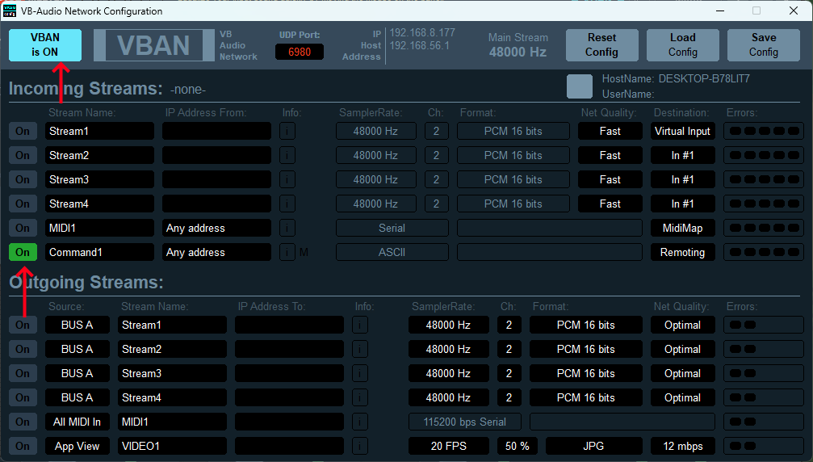
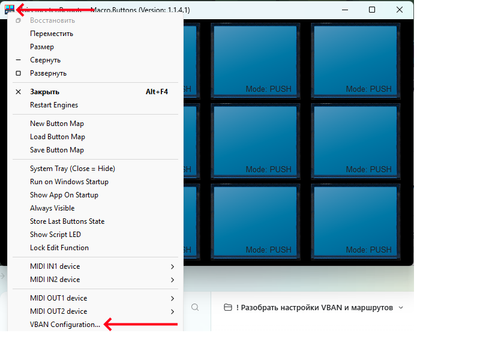
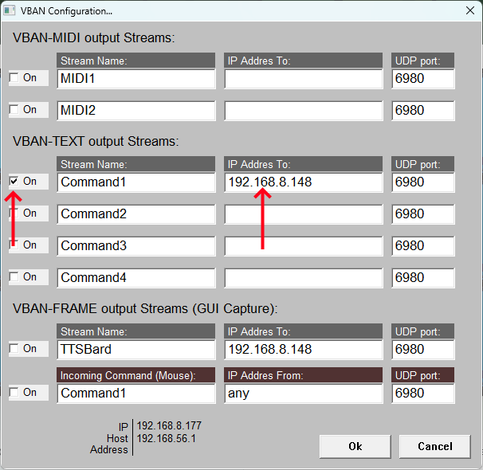
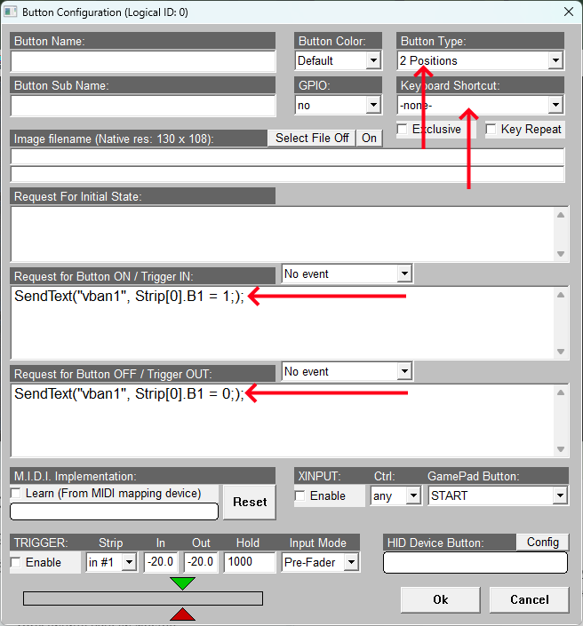

# TTSBard → Voicemeeter → OBS и Discord

TTSBard отправляет один аудиопоток на стрим‑ПК. Voicemeeter подаёт озвучку в Discord через B1. Для OBS используется отдельный аудиовыход A с захватом соответствующего устройства в OBS. Macro Buttons на игровом ПК отправляет отдельную команду и переключает только подачу TTS в B1.

Для этой схемы достаточно обычного **Voicemeeter**. Его виртуальный выход B используется для Discord. В Windows он может отображаться как **Voicemeeter Out B1**. На панели обычного Voicemeeter кнопка подачи в него обозначена **B**.

## Что установить

- **Стрим‑ПК.** Скачай обычный **Voicemeeter**, распакуй ZIP, запусти установщик от администратора и перезагрузи Windows. [Скачать Voicemeeter](https://vb-audio.com/Voicemeeter/index.htm)
- **Игровой ПК.** Запусти имеющийся `C:\Program Files (x86)\VB\Voicemeeter\VoicemeeterMacroButtons.exe`. Для установки с нуля доступен отдельный ZIP Macro Buttons. [Скачать Macro Buttons](https://vb-audio.com/Voicemeeter/macrobuttons.htm)

| Параметр | Пример |
|---|---|
| Игровой ПК | `192.168.8.177` |
| Стрим‑ПК | `192.168.8.148` |
| Порт VBAN | UDP `6980` |
| Имя аудиопотока | Как указано в настройках TTSBard |
| Имя потока команд | `Command1` |

Подставь фактические адреса своих ПК. **IP Address To** — адрес получателя, **IP Address From** — адрес отправителя.

## 1. Стрим‑ПК — Voicemeeter

### Включить приём звука и команд

1. Запусти Voicemeeter. В **Hardware Out → A1** выбери работающие наушники или колонки стрим‑ПК.
2. Открой **VBAN** и включи **VBAN is ON**. Проверь **UDP Port**.
3. В **Incoming Streams** включи свободную строку **аудиопотока**. Укажи имя потока из TTSBard, IP игрового ПК в **IP Address From** и выбери входную дорожку в **Destination**. Для команд ниже удобно назначить TTS на первый вход **In #1**.
4. В той же секции включи строку **Command1** с форматом **ASCII** и назначением **Remoting**. В **IP Address From** укажи IP игрового ПК.



На скриншоте показано расположение переключателей. Адрес в **IP Host Address** относится к компьютеру, на котором сделан снимок. Строка **Command1** на снимке принимает с **Any address**, а аудиостроки выключены. Для рабочей схемы заполни и включи свою аудиостроку и укажи IP игрового ПК в строке команд.

### Назначить выходы для Discord и OBS

1. На дорожке TTS включи **B** для Discord и **A** для отдельной подачи в OBS. Если в Discord нужен живой микрофон, подай его в B со своей дорожки.
2. В **Discord → Голос и видео** выбери **Voicemeeter Out B1** устройством ввода.
3. В OBS захватывай устройство, на которое направлен выход A. Если OBS уже получает этот звук, используй настроенный источник. Для выделенной подачи можно назначить A2 на **CABLE Input**, а в OBS добавить **«Захват входного аудиопотока» → CABLE Output**. Этот вариант требует установленного VB-CABLE на стрим‑ПК. Проверь, что A1 также настроен на доступное устройство.

## 2. Игровой ПК — TTSBard и Macro Buttons

### Отправить тестовый звук из TTSBard

1. В **TTSBard → Аудио → VBAN** включи VBAN, укажи IP стрим‑ПК и порт. Имя аудиопотока должно совпадать с именем аудиостроки в Voicemeeter.
2. Отправь длинную фразу. На стрим‑ПК должны двигаться индикаторы дорожки TTS и **MASTER A/B**. Выключи **B на дорожке TTS** вручную. Discord должен перестать получать TTS, а OBS — продолжить получать его через выход A.

### Настроить адрес стрим‑ПК в Macro Buttons

На игровом ПК запусти `C:\Program Files (x86)\VB\Voicemeeter\VoicemeeterMacroButtons.exe`. Если файла нет, VB‑Audio публикует отдельную сборку Macro Buttons для Windows. [Скачать Macro Buttons](https://vb-audio.com/Voicemeeter/macrobuttons.htm)

В окне **Macro Buttons** нажми значок в левом верхнем углу или `Alt+Space`, затем выбери **VBAN Configuration…**.



В средней секции **VBAN‑TEXT output Streams** включи **первую строку**. Введи **Stream Name** `Command1`, **IP Address To** стрим‑ПК и **UDP port** `6980` или порт из Voicemeeter. Нажми **OK**. Для этого переключателя достаточно строки VBAN‑TEXT.



### Создать кнопку «TTS в Discord»

Щёлкни правой кнопкой по свободной макрокнопке и выбери **Button Type → 2 Positions**. В **Button Name** можно написать `TTS в Discord`. **Request For Initial State** оставь пустым.

**Request for Button ON**

```text
SendText("vban1", Strip[0].B1 = 1;);
```

**Request for Button OFF**

```text
SendText("vban1", Strip[0].B1 = 0;);
```



`vban1` выбирает первую строку **VBAN‑TEXT output Streams**. `Strip[0]` — первая входная дорожка Voicemeeter. Если TTS приходит на другую дорожку, подставь её индекс. `B1` в команде API соответствует виртуальной шине B обычного Voicemeeter, которая в этой схеме используется для Discord.

Нажми **OK** и проверь оба состояния кликом мыши. На стрим‑ПК должна переключаться **B именно на дорожке TTS**, а A должна оставаться включённой. После проверки назначь комбинацию в **Keyboard Shortcut**. На скриншоте она ещё не назначена.

## Если что-то не работает

| Симптом | Что проверить |
|---|---|
| На входной дорожке Voicemeeter нет уровня | Сверь имя аудиопотока, IP, UDP-порт, состояние строки и **Destination**. |
| Входная дорожка показывает уровень, а MASTER B стоит | Проверь **B** на дорожке TTS, её **Mute** и фейдер, затем **Mute** и фейдер шины B. |
| MASTER B показывает уровень, а запись пуста | Открой **Win+R → mmsys.cpl → Запись** и проверь индикатор **Voicemeeter Out B1**. Если он движется, явно выбери Out B1 входом в программе записи. Если стоит, проверь, что устройство включено и выбрана нужная шина. |
| В Windows есть уровень, а в наушниках тихо | В свойствах B1 на вкладке **Прослушать** проверь выбранное устройство воспроизведения. Для Discord и OBS прослушивание можно оставить выключенным. |
| B вручную работает, а макрокнопка не переключает | Проверь **Command1** на обеих сторонах, IP в обе стороны, порт, первую строку VBAN‑TEXT и индекс дорожки. Для одиночного теста временно очисти поле OFF, вручную выключи B и проверь, включает ли подачу в B команда ON. |

## Источники

- [Настройки VBAN в руководстве Voicemeeter](https://vb-audio.com/Voicemeeter/Voicemeeter_UserManual.pdf)
- [Настройка VBAN‑TEXT в Macro Buttons](https://vb-audio.com/Voicemeeter/Voicemeeter_UserManual.pdf)
- [Параметры Voicemeeter Remote API](https://download.vb-audio.com/Download_CABLE/VoicemeeterRemoteAPI.pdf)

